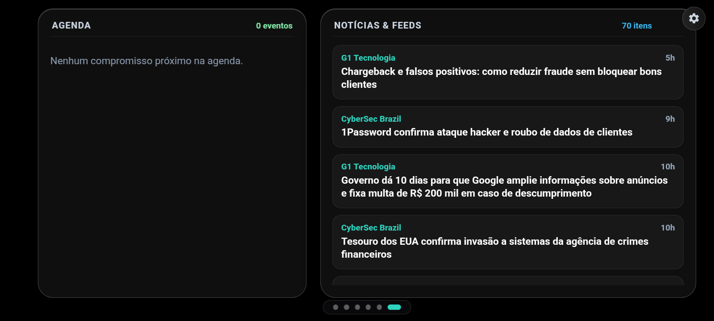

# Nuvra Dock (v1.0.1) 📱🖥️🍎

> **Transforme qualquer smartphone ou tablet Android em um Smart Desk Panel & Control Deck interativo para Windows, macOS (Apple Silicon, Intel & Hackintosh) e Linux.**  
> Execução 100% local na sua rede ou via USB/ADB (sem nuvem, sem assinaturas e sem intermediários).

> [!IMPORTANT]
> **Por que o nome mudou de *PhoneDesk* para *Nuvra Dock*?**  
> A virada oficial para **Nuvra Dock** na versão `v1.0.1` foi realizada para **evitar confusão com outros sistemas de telefonia, suporte e segunda tela já existentes no mercado com o nome *PhoneDesk***, consolidando uma identidade própria e exclusiva para o projeto e futuras extensões da comunidade.  
> Na primeira execução, o **Nuvra Dock** migra automaticamente suas configurações anteriores (`PhoneDesk`) e substitui o aplicativo antigo no celular via ADB sem perda de dados!

---

## 🆕 Novidades da Release v1.0.1

- **Virada Oficial para Nuvra Dock (`NuvraDockAgent` + `com.nuvradock.app`):**
  - Migração automática de `config.json` e dispositivos Wi-Fi salvos da pasta antiga `PhoneDesk` para `NuvraDock`.
  - Migração automática do APK Android: ao conectar qualquer celular com o app antigo (`PhoneDesk`), o agente instala o `NuvraDock.apk` (`com.nuvradock.app`) e remove o pacote legado automaticamente via ADB.
- **Compatibilidade Completa com macOS (Apple Silicon `arm64`, Intel `x64` e Hackintosh):**
  - Telemetria nativa de CPU via Mach Kernel (`host_statistics`) e memória RAM via `vm_stat` / `sysctl`.
  - Extração automática de ícones reais `.icns` dos aplicativos em `/Applications` via `sips`.
  - Controle nativo de volume, mídia (*Now Playing* / Spotify / Apple Music) e sincronização de bloqueio de tela (`followComputerLock`).
- **Wi-Fi ADB Automático Multiplataforma (Windows, macOS & Linux) para Qualquer Android:**
  - Basta conectar qualquer celular ou tablet Android no USB uma única vez: o agente detecta automaticamente a interface Wi-Fi do aparelho (`wlan*`, `swlan*`, `ap*`), ativa a porta `5555`, salva o vínculo e reconecta sozinho em segundo plano toda vez que o computador ligar — permitindo deixar o aparelho direto no carregador de parede sem cabo no PC.
- **Conexão Android Blindada (Zero Tela Preta):** overlay nativo *"Nuvra Dock · Conectando…"* com reconexão transparente e identificação correta de status `Wi-Fi` vs `USB` no Estúdio.
- **Auto-Updater Escalável (Zero Erro 403):** verificação diária (`24h` com *jitter*) via redirecionamento web do GitHub sem esgotar a cota de 60 req/h da REST API.
- **Clima Simplificado & Preciso:** exibição limpa (`Cidade • Sensação X°`) com seleção de modelos meteorológicos Open-Meteo (`UKMO`, `ICON`, `ECMWF`, `GFS`) e alertas de severidade em tempo real.
- **Endurecimento de Segurança:** token habilitado por padrão para acessos externos na LAN (`webRequireToken: true`), WebView Android restrito a origens locais sem acesso a `file://` e adição de [SECURITY.md](SECURITY.md).

---

## 💻 Compatibilidade de Sistemas

| Plataforma | Arquiteturas | Recursos Nativos Suportados |
| :--- | :--- | :--- |
| **Windows 10 / 11** | `win-x64` | System Tray, SMTC Media, CoreAudio/WASAPI, PerformanceCounters, Descoberta de Programas, Auto-Start, Wi-Fi ADB Auto-Reconnect |
| **macOS 12+ & Hackintosh** | `osx-arm64`, `osx-x64` | LaunchAgent, Mach CPU & `vm_stat` RAM, Áudio/Mídia (`osascript`), Ícones `.app` (`.icns` via `sips`), Lock Sync, Wi-Fi ADB Auto-Reconnect |
| **Linux** | `linux-x64`, `linux-arm64` | Systemd User, `/proc` Telemetry, PipeWire/PulseAudio (`wpctl`/`pactl`), Ícones `.desktop`, Wi-Fi ADB Auto-Reconnect |
| **Android 7.0+ (API 24+)** | Qualquer aparelho | Kiosk Fullscreen Imersivo, `FLAG_KEEP_SCREEN_ON`, Eco StandBy Dimming, Conexão Híbrida USB + Wi-Fi |

---

## 🎨 Motor de Temas Exclusivo com Pré-Visualização Ao Vivo
Diferente de projetos com layouts engessados e temas bloqueados, o **Nuvra Dock** traz um **Theme Engine completo** no navegador do computador com visualização em tempo real antes de aplicar no celular:


- **Temas Prontos de Fábrica:** **OLED StandBy**, **Nordic Light**, **Cobalt Desk**, **Carbon Pro**, **Amber Desk**, **Crimson Studio**, **Forest Moss** e **Sunset Slate**.
- **Personalização Total:** Fundo (gradiente ou sólido), cores do relógio, transparência Liquid Glass, bordas arredondadas e CSS personalizado.

---

## 📸 Vitrine de Funcionalidades

### 1. Home — Relógio, Clima Exato & Alertas Meteorológicos


### 2. Stream Deck — Gaveta Universal de Programas (Windows & macOS)


### 3. Mídia & Controle de Volume


### 4. Telemetria de Hardware em Tempo Real


### 5. Agenda & Feeds RSS de Notícias


### 6. Central de Controle (`Nuvra Dock Studio`)


---

# 📖 Manual Passo a Passo de Instalação

## 🪟 No Windows
1. Execute o `NuvraDockAgent.exe` (migra automaticamente dados anteriores do *PhoneDesk* e inicia em segundo plano).
2. Acesse o **Nuvra Dock Studio** em **`http://127.0.0.1:8765/`** (ou `http://localhost:8770/settings`).
3. Conecte qualquer celular ou tablet Android via USB com Depuração USB ativa uma vez: o agente instalará automaticamente o `NuvraDock.apk` (`com.nuvradock.app`), removerá versões antigas e provisionará o Wi-Fi ADB!

## 🍎 No macOS (Apple Silicon, Intel & Hackintosh)
1. Compile e publique o binário nativo para a arquitetura do seu Mac (`.NET 10 SDK`):
   ```bash
   # Mac Intel / Hackintosh (x64)
   dotnet publish agent/NuvraDock.Agent/NuvraDock.Agent.csproj -f net10.0 -r osx-x64 --self-contained -c Release -o ~/Library/Application\ Support/NuvraDock/app

   # Mac Apple Silicon (M1 / M2 / M3 / M4)
   dotnet publish agent/NuvraDock.Agent/NuvraDock.Agent.csproj -f net10.0 -r osx-arm64 --self-contained -c Release -o ~/Library/Application\ Support/NuvraDock/app
   ```
2. Copie os arquivos do painel web (`index.html`, `manifest.json`, `sw.js`, `icon.svg`, `widgets.json`, `templates.json`, `panel/`) para `~/Library/Application Support/NuvraDock/app/www/` e `NuvraDock.apk` para `~/Library/Application Support/NuvraDock/app/`.
3. Acesse o **Nuvra Dock Studio** no Mac em **`http://127.0.0.1:8765/`**.
4. Conecte qualquer Android via **USB** uma vez — depois pode desconectar o cabo e deixar o aparelho direto no carregador que o `NuvraDockAgent` reconecta sozinho pelo Wi-Fi sempre que o Mac iniciar!

---

## 📄 Licença
Distribuído sob a licença MIT. Baseado inicialmente na arquitetura open-source do [PhoneBox](https://github.com/ersinkoc/phonebox), expandido e reestruturado como **Nuvra Dock**. Veja [THIRD-PARTY-NOTICES.txt](agent/NuvraDock.Agent/THIRD-PARTY-NOTICES.txt) e [SECURITY.md](SECURITY.md).
