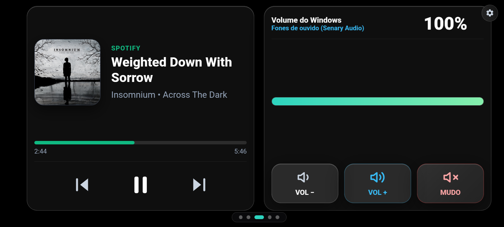
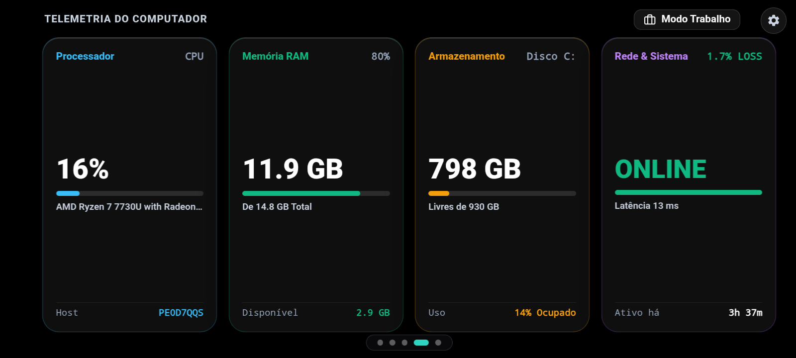

# PhoneDesk 📱🖥️

> **Transforme qualquer smartphone ou tablet em um Smart Desk Panel & Control Deck interativo para o seu computador.**  
> 100% de código aberto, execução totalmente local na sua rede (sem nuvem, sem assinaturas e sem intermediários).

---

## 📸 Demonstração Visual (O que você vê na mesa)

### 1. Central de Controle no Computador (`PhoneDesk Studio`)
Configure tudo de forma visual no seu navegador no PC com pré-visualização em tempo real das telas:


*Adicione programas em um clique pelo botão `+ Programas instalados`, personalize cores, ordene atalhos, configure clima e feeds com sincronização instantânea com o celular.*

---

### 2. Stream Deck de Produtividade & Controles
Dispare programas, sites, atalhos de teclado e ferramentas do Windows com um toque na mesa:


- Botões táteis com ícones e cores automáticas.
- Disparo ultra-rápido de executáveis, scripts e atalhos do Windows.
- Botão nativo de bloqueio rápido da estação de trabalho.

---

### 3. Mídia & Controle de Volume do Windows
Controle tudo o que está tocando no seu computador sem precisar trocar de janela:



- Capa do álbum em alta resolução, nome da música, artista e barra de progresso em tempo real (Spotify, YouTube, VLC, navegadores).
- Controle de som master do Windows via CoreAudio/WASAPI (`VOL −`, `VOL +`, `MUDO`) com slider tátil e nome do dispositivo de saída de áudio ativo.

---

### 4. Telemetria de Hardware em Tempo Real
Monitore a saúde do seu computador direto no painel com consumo mínimo de recursos:



- Uso real de **Processador (CPU)** e nome do chip.
- Memória **RAM** em uso e total disponível.
- Espaço livre no **Disco C:** em GB e porcentagem.
- **Rede & Sistema:** latência de ping em tempo real, status de conexão e tempo de atividade do PC (Uptime).
- Alternância rápida para perfil com métricas avançadas.

---

### 5. StandBy Clock & Clima
Mantenha sua mesa elegante e informada enquanto trabalha:


- Relógio digital gigante com excelente visibilidade e data completa em português.
- Previsão do tempo ao vivo (temperatura, sensação térmica e ícones vetoriais de tempo).
- Status inteligente do próximo compromisso da sua agenda.

---

### 6. Agenda & Notícias / Feeds RSS
Acompanhe seus compromissos e as últimas notícias do dia sem abrir abas extras no PC:


- Próximos eventos sincronizados com seus calendários `.ics` (Outlook, Google Agenda, Teams).
- Manchetes em tempo real de feeds RSS/Atom com toque direto para abrir a matéria completa no monitor do computador.

---

# 📖 Manual Passo a Passo de Configuração

Este guia foi feito para que **qualquer pessoa configure o PhoneDesk do zero no Windows sem complicação**.

---

### Passo 1 — Iniciar o PhoneDesk no seu PC
1. Dê dois cliques no atalho **PhoneDesk** na sua **Área de Trabalho** (ou abra pelo menu Iniciar).
2. O aplicativo roda automaticamente em segundo plano como serviço local do Windows, sem deixar janelas pretas de terminal abertas.
*(O PhoneDesk também já é configurado para iniciar automaticamente junto com o Windows).*

---

### Passo 2 — Abrir o Painel de Configurações
1. No seu navegador no computador (Chrome, Edge, Firefox, Brave), acesse:
   👉 **`http://localhost:8770/settings`** (ou `http://127.0.0.1:8765/`)
2. Você verá o **PhoneDesk Studio**, onde todas as funções são configuradas visualmente.

---

### Passo 3 — Adicionar seus Aplicativos ao Stream Deck (1 Clique)
1. No menu lateral do PhoneDesk Studio, clique em **Páginas** ou **Atalhos**.
2. Clique no botão azul **`+ Programas instalados`** (no canto inferior esquerdo).
3. Uma lista com todos os aplicativos detectados no seu Windows será exibida (WhatsApp, Spotify, navegadores, ferramentas, jogos).
4. Basta clicar no programa que você quer adicionar. O atalho é criado imediatamente com ícone e comando prontos!

---

### Passo 4 — Conectar o seu Celular ou Tablet

Você tem duas formas simples de conectar:

#### Opção A: Aplicativo Android Nativo Dedicado (Recomendado — Tela Cheia Pura)
1. Conecte o seu celular/tablet ao computador via cabo USB (com depuração USB ativada).
2. O arquivo do aplicativo já está compilado no projeto:  
   📁 `android/app/build/PhoneDesk.apk`
3. Instale no celular executando no terminal:
   ```bash
   adb install -r android/app/build/PhoneDesk.apk
   ```
4. O app **PhoneDesk** aparecerá no menu do celular com ícone próprio. Ao abrir, ele roda em **tela cheia imersiva** (sem barra de navegador, sem abas e com a tela travada para nunca apagar no suporte de mesa).

#### Opção B: Pelo Navegador do Celular (Via Wi-Fi)
1. Verifique se o celular está conectado na mesma rede Wi-Fi do computador.
2. Na tela de configurações no PC, veja o seu endereço de rede (exemplo: `http://192.168.101.72:8770/`).
3. Abra esse endereço no navegador do celular (Chrome ou Samsung Internet).
4. Toque no botão de tela cheia ou adicione à tela inicial como WebApp/PWA.

---

### Passo 5 — Personalizar Clima, Temas e Notícias
- **Clima da sua cidade:** No menu **Geral**, digite o nome da sua cidade no campo Clima (ex: `Juiz de Fora`, `São Paulo`, `Rio de Janeiro`) e clique em **Salvar**.
- **Notícias favoritas:** No menu **Páginas**, vá na seção de Feeds e adicione a URL RSS dos portais que você gosta de acompanhar.
- **Mudar o visual:** No menu **Temas**, escolha entre temas como *OLED StandBy (Preto)*, *Nordic Light (Claro)*, *Cobalt Desk (Azul Executivo)*, *Carbon Pro* ou crie suas próprias cores.

---

# 🛠️ Documentação Técnica & Arquitetura (Para Desenvolvedores)

Para quem deseja auditar o código, contribuir ou criar extensões para o PhoneDesk:

### Arquitetura da Solução
- **Agente Desktop:** Desenvolvido em **.NET 10** (`agent/PhoneDesk.Agent`), autocontido e nativo para Windows 10/11:
  - Servidor HTTP leve Kestrel escutando em `0.0.0.0:8770` (para o painel do celular) e `127.0.0.1:8765` (para o Studio local).
  - Acesso direto a APIs do Windows: `Windows.Media.Control` (SMTC para Spotify/mídia), `CoreAudio/WASAPI` (volume centavo a centavo sem distorção) e `PerformanceCounters` (CPU/RAM/Disco).
  - Túnel reverso USB ADB integrado (`UsbLink.cs`) para comunicação zero-latency via cabo.
- **Cliente Android Nativo:** Projeto Java puro (`android/app`) utilizando Android SDK 34+, WebView acelerada por hardware, flags de imersão de sistema (`IMMERSIVE_STICKY`) e gerenciamento de energia (`FLAG_KEEP_SCREEN_ON`).
- **Interface do Painel:** HTML5 + CSS Variables semânticas (`index.html`), zero frameworks pesados, 60 FPS garantidos mesmo em smartphones de entrada.

### Compilação do Agente (.NET 10)
```bash
# Executar em modo desenvolvimento
dotnet run --project agent/PhoneDesk.Agent/PhoneDesk.Agent.csproj -f net10.0-windows10.0.19041.0

# Publicar executável compilado de alto desempenho
dotnet publish agent/PhoneDesk.Agent/PhoneDesk.Agent.csproj -c Release -r win-x64 --self-contained false -f net10.0-windows10.0.19041.0
```

### Estrutura de Diretórios
```text
├── agent/PhoneDesk.Agent/   # Código do agente Windows (.NET 10 / C#)
├── android/                 # Projeto do aplicativo Android nativo (Java/APK)
├── docs/screenshots/        # Capturas de tela reais das funcionalidades
├── panel/                   # Recursos base e assets de visualização
├── index.html               # Painel principal do PhoneDesk (5 telas)
├── icon.svg                 # Identidade visual em vetor
├── config.json              # Configuração padrão do sistema
└── README.md                # Documentação e manual de uso
```

---

## 📄 Licença
Distribuído sob a licença MIT. Baseado tecnicamente no projeto de código aberto [PhoneBox](https://github.com/ersinkoc/phonebox), adaptado e expandido como **PhoneDesk**. Veja [THIRD-PARTY-NOTICES.txt](agent/PhoneDesk.Agent/THIRD-PARTY-NOTICES.txt) para avisos de terceiros.
