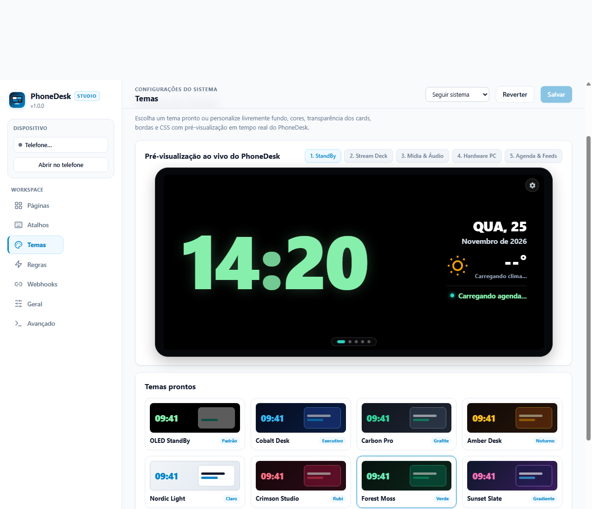
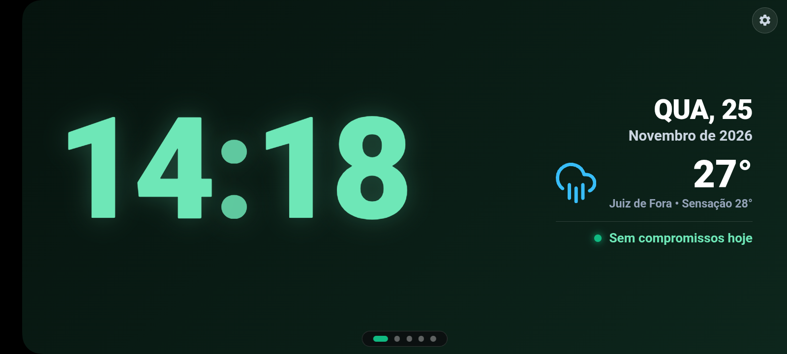
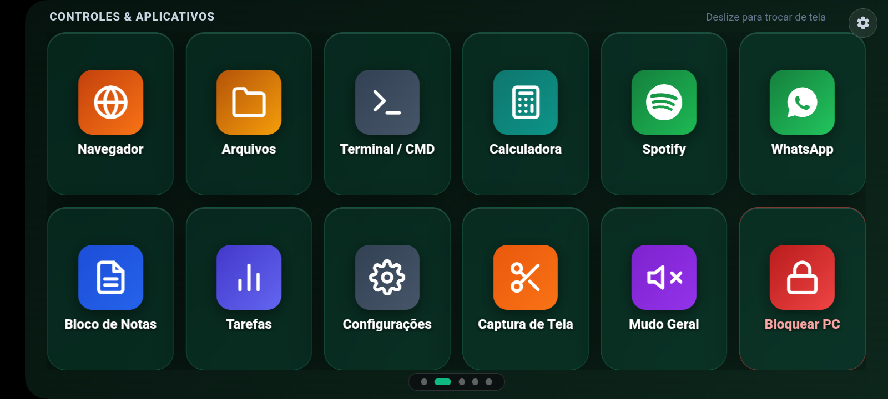
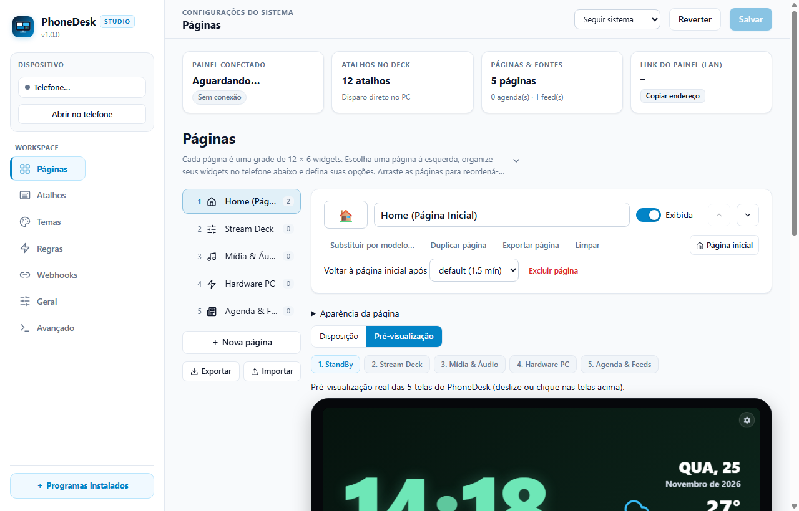

# PhoneDesk (v1.0.0) 📱🖥️

> **Transforme qualquer smartphone ou tablet em um Smart Desk Panel & Control Deck interativo para o seu computador.**  
> 100% de código aberto, execução totalmente local na sua rede (sem nuvem, sem assinaturas e sem intermediários).

---

## 🎨 O Grande Diferencial: Motor de Temas Exclusivo com Pré-Visualização Ao Vivo
Diferente de projetos originais com layouts engessados e temas bloqueados, o **PhoneDesk** traz um **Theme Engine completo** no navegador do PC com visualização em tempo real antes de aplicar no celular:



- **Temas Prontos de Fábrica:**
  - 🖤 **OLED StandBy:** Preto absoluto de contraste infinito para economia de bateria em telas AMOLED.
  - ☀️ **Nordic Light:** Tema claro diurno corporativo com alto contraste garantido (zero texto invisível).
  - 🔵 **Cobalt Desk:** Azul executivo de alta densidade visual.
  - 🔘 **Carbon Pro:** Grafite metálico para setups minimalistas.
  - 🌙 **Amber Desk:** Âmbar noturno quente e repousante para os olhos.
  - 💎 **Crimson Studio, Forest Moss & Sunset Slate:** Gradientes refinados.
- **Personalização Total:** Fundo (gradiente ou sólido), cores do relógio, transparência Liquid Glass, bordas arredondadas e injeção de CSS personalizado.

---

## 📸 Vitrine de Funcionalidades (O que você vê na mesa)

### 1. Home (Página Inicial) — Relógio, Clima Exato & Alertas Meteorológicos
Mantenha sua mesa informada e elegante com dados em tempo real:



- **Relógio Digital Gigante:** Visibilidade nítida à distância com data completa em português.
- **Clima com Geolocalização Automática:** Temperatura e sensação térmica calculadas com as coordenadas exatas da sua cidade (Open-Meteo).
- **Alertas Meteorológicos em Tempo Real (El Niño / Tempestades):** O painel monitora e avisa automaticamente na tela em situações críticas:
  - 🔥 *Alerta de Calor Extremo (El Niño)* quando a sensação ultrapassa 33°C.
  - ⛈️ *Alerta de Tempestade & Rajadas de Vento* para ventos fortes ou temporais.
  - 🌧️ *Alerta de Chuva Torrencial* com risco de alagamento.
  - 💧 *Alerta de Baixa Umidade do Ar* e *Frio Intenso*.

---

### 2. Stream Deck — Gaveta Padrão Universal de Programas
Acesse seus programas e ferramentas essenciais do Windows com um único toque na tela:



- **12 Atalhos Universais Prontos de Fábrica:**
  - 🌐 **Navegador** (Abre seu navegador padrão)
  - 📁 **Arquivos** (Explorador de Arquivos do Windows)
  - ⌨️ **Terminal / CMD** (Prompt ou Windows Terminal)
  - 🔢 **Calculadora**
  - 🎵 **Spotify**
  - 💬 **WhatsApp Web**
  - 📝 **Bloco de Notas**
  - 📊 **Gerenciador de Tarefas**
  - ⚙️ **Configurações do Windows**
  - ✂️ **Captura de Tela** (Ferramenta de recorte)
  - 🔇 **Mudo Geral**
  - 🔒 **Bloquear PC** (Trava instantânea da estação de trabalho)
- **Adicione Qualquer Programa em 1 Clique:** Pelo botão `+ Programas instalados` no PC, o PhoneDesk lista todos os seus programas e jogos para adicionar à mesa instantaneamente.

---

### 3. Mídia & Controle de Volume do Windows
Controle músicas e o áudio master do seu PC sem precisar alternar entre janelas:


- Capa do álbum em alta resolução, nome da música, artista e barra de progresso em tempo real (Spotify, YouTube, VLC, navegadores).
- Controle de som master do Windows via CoreAudio/WASAPI (`VOL −`, `VOL +`, `MUDO`) com slider tátil e indicação do dispositivo ativo (ex: *Fones de ouvido* ou *Caixas de som*).

---

### 4. Telemetria de Hardware em Tempo Real
Acompanhe o desempenho do computador com telemetria direta do Windows:


- Uso real do **Processador (CPU)** e modelo do chip.
- Consumo de **Memória RAM** (em uso e total disponível).
- Espaço em disco livre no **Drive C:** (GB livres e porcentagem ocupada).
- **Rede & Sistema:** latência de ping, status de conexão e tempo de atividade do PC (Uptime).

---

### 5. Agenda & Feeds RSS de Notícias
Acompanhe seus compromissos e notícias sem abrir abas extras no monitor:


- Próximos eventos sincronizados com seus calendários `.ics` (Outlook, Google Agenda, Teams).
- Manchetes em tempo real de feeds RSS/Atom com toque direto para abrir a matéria completa no monitor do computador.

---

### 6. Central de Controle no Computador (`PhoneDesk Studio`)
Gerencie tudo de forma visual e organizada no navegador do seu PC:



- Lista limpa das **5 Páginas Oficiais**:
  1. `🏠 Home (Página Inicial)`
  2. `🎛️ Stream Deck`
  3. `🎵 Mídia & Áudio`
  4. `⚡ Hardware PC`
  5. `📰 Agenda & Feeds`
- Botão **`+ Programas instalados`** para varrer o Windows e puxar programas instalados em um clique.

---

# 📖 Manual Passo a Passo de Configuração

Guia simples e direto para qualquer pessoa configurar o PhoneDesk no Windows:

---

### Passo 1 — Abrir o PhoneDesk no Computador
1. Dê dois cliques no atalho **PhoneDesk** na sua **Área de Trabalho** (ou pelo menu Iniciar).
2. O serviço inicia silenciosamente em segundo plano e já fica pronto para conexões.
*(O PhoneDesk é instalado para iniciar sozinho junto com o Windows).*

---

### Passo 2 — Abrir a Central de Configurações no Navegador
1. No seu navegador no PC (Chrome, Edge, Firefox, Brave), acesse:
   👉 **`http://localhost:8770/settings`** (ou `http://127.0.0.1:8765/`)
2. Você verá o **PhoneDesk Studio**.

---

### Passo 3 — Adicionar Programas ao seu Stream Deck
1. Na aba **Páginas** ou **Atalhos**, clique no botão azul **`+ Programas instalados`** (no canto inferior esquerdo).
2. Clique no programa que deseja (jogos, navegadores, ferramentas). Ele será adicionado à grade da mesa instantaneamente!

---

### Passo 4 — Conectar o seu Celular ou Tablet

#### Opção A: Aplicativo Android Nativo (Recomendado — Imersão Total de Mesa)
1. Conecte o celular ao computador via cabo USB (com depuração USB ativada).
2. O aplicativo nativo do PhoneDesk já vem compilado no repositório:  
   📁 `android/app/build/PhoneDesk.apk`
3. Instale com o comando:
   ```bash
   adb install -r android/app/build/PhoneDesk.apk
   ```
4. Abra o **PhoneDesk** no celular. Ele roda em **tela cheia nativa** (sem barra de URL de navegador, sem abas e com a tela travada para nunca apagar no suporte de mesa).

#### Opção B: Pelo Navegador do Celular (Via Wi-Fi)
1. Conecte o celular no mesmo Wi-Fi do PC.
2. No celular, abra o endereço exibido no PhoneDesk Studio (exemplo: `http://192.168.101.72:8770/`).
3. Adicione à tela inicial como PWA para navegar em tela cheia.

---

### Passo 5 — Personalizar Clima e Temas
- **Clima com Alertas da sua Cidade:** No menu **Geral**, digite o nome da sua cidade (ex: `São Paulo`, `Juiz de Fora`, `Curitiba`) e clique em **Salvar**. As coordenadas exatas e os alertas meteorológicos serão configurados sozinhos.
- **Temas:** No menu **Temas**, clique em qualquer um dos 8 temas prontos ou crie o seu.

---

# 🔄 Atualizações Automáticas (Auto-Updates)

O PhoneDesk conta com sistema integrado de atualização contínua:
- **No Computador (Agente Windows):** O `PhoneDeskAgent` verifica automaticamente novas versões no repositório oficial do GitHub (`GermanoRoberto/phonedesk`). Quando uma nova versão for publicada, o PhoneDesk Studio exibirá o aviso com botão de **"Atualizar"**, baixando a nova versão e aplicando os arquivos sem você precisar reinstalar.
- **No Celular/Tablet:**
  - O painel web se recarrega automaticamente com novidades assim que o PC atualiza.
  - O APK Android nativo é atualizado pelo agente via USB (`adb install -r`) sem intervenção manual.

---

# 🛠️ Arquitetura Técnica (Para Desenvolvedores)

- **Agente Desktop (.NET 10 / C#):**
  - Servidor Kestrel HTTP nativo em `0.0.0.0:8770` e `127.0.0.1:8765`.
  - Integração Windows SMTC (`Windows.Media.Control`), CoreAudio/WASAPI e `PerformanceCounters`.
  - Túnel reverso ADB USB integrado (`UsbLink.cs`).
  - Serviço de geocodificação e telemetria climática Open-Meteo (`WeatherService.cs`).
  - Serviço de atualização contínua via GitHub Releases (`UpdateService.cs`).
- **Aplicativo Android Nativo (Java / Android SDK 34+):**
  - WebView acelerada por hardware com `IMMERSIVE_STICKY`, `FLAG_KEEP_SCREEN_ON` e orientação horizontal (`sensorLandscape`).
- **Interface Front-end:**
  - HTML5 puro + CSS Variables semânticas, 60 FPS garantidos e modo claro/escuro com proteção de contraste WCAG AA.

### Compilação do Agente
```bash
dotnet publish agent/PhoneDesk.Agent/PhoneDesk.Agent.csproj -c Release -r win-x64 --self-contained false -f net10.0-windows10.0.19041.0
```

---

## 📄 Licença
Distribuído sob a licença MIT. Baseado tecnicamente no projeto de código aberto [PhoneBox](https://github.com/ersinkoc/phonebox), adaptado e expandido como **PhoneDesk**. Veja [THIRD-PARTY-NOTICES.txt](agent/PhoneDesk.Agent/THIRD-PARTY-NOTICES.txt) para avisos de terceiros.
